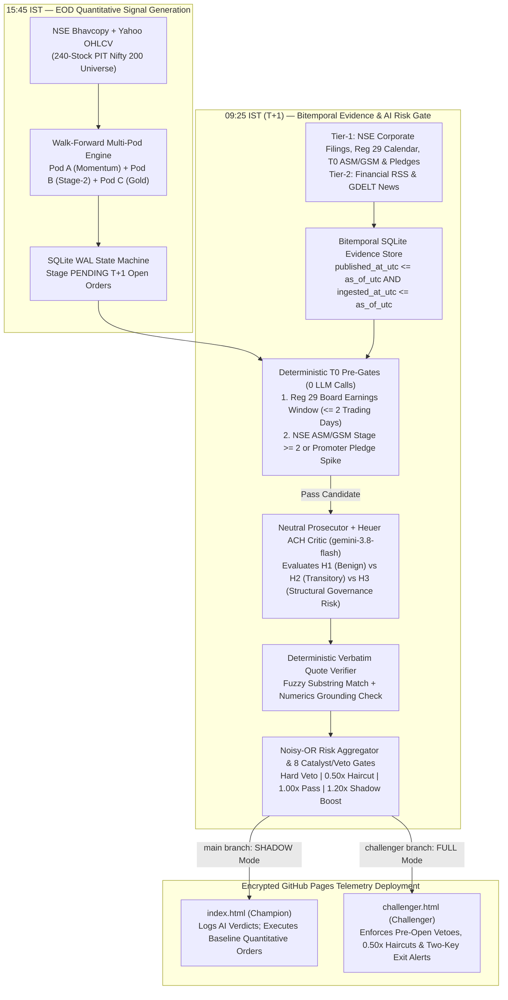

# NIFTY 200 EOD Quantitative Engine & Point-in-Time AI Research Advisor — Encrypted Telemetry & Engineering Post-Mortem

[-10b981?style=flat-square)](https://himanshu2408.github.io/nifty-eod-dashboard/)
[-6366f1?style=flat-square)](https://himanshu2408.github.io/nifty-eod-dashboard/challenger.html)

[-f59e0b?style=flat-square)](#4-point-in-time-bitemporal-ai-research-advisor--championchallenger-architecture)

This repository hosts the twice-daily encrypted telemetry dashboards deployed by the private **`nifty-eod-engine`** pipeline, alongside the complete **engineering failure post-mortem** of the initial `v2.1.0` baseline (`3.06%` CAGR, `-0.461` Sharpe) and its subsequent **Walk-Forward Out-of-Sample (OOS) + Point-in-Time Agentic Rebuild** (`14.19%` CAGR, `+9.47%` annualized net alpha after `~51.5 bps` round-trip statutory Indian cash-delivery friction).

---

## 1. Repository Artifacts & Why Telemetry Is Client-Side Encrypted

The private `nifty-eod-engine` GitHub Actions workflow runs twice each NSE trading day (`09:25 IST` Morning Open Fill & Pre-Open AI Risk Audit, and `15:45 IST` EOD Signal Generation) and pushes two static telemetry bundles to this repository:

| Telemetry Artifact | Live URL | Branch / Execution Mode | Role in Champion vs. Challenger Loop |
| :--- | :--- | :--- | :--- |
| **[`index.html`](https://himanshu2408.github.io/nifty-eod-dashboard/)** | `https://himanshu2408.github.io/nifty-eod-dashboard/` | `main` (`RESEARCH_ENFORCEMENT_MODE=SHADOW`) | **Champion Baseline:** Executes the causal Walk-Forward OOS Multi-Pod Quantitative Engine (`Pod A` Momentum + `Pod B` Stage-2 Breakout + `Pod C` Gold ETF Reserve). Runs the `gemini-3.8-flash` AI Research Advisor in **Shadow Mode** (recording structured verdicts, Noisy-OR risk scores, and Heuer ACH matrices to SQLite without blocking baseline orders). |
| **[`challenger.html`](https://himanshu2408.github.io/nifty-eod-dashboard/challenger.html)** | `https://himanshu2408.github.io/nifty-eod-dashboard/challenger.html` | `challenger` (`CHALLENGER_ENFORCEMENT_MODE=FULL`) | **Challenger Agentic Gate:** Identical capital ledger and signal engine, but the Point-in-Time `gemini-3.8-flash` AI Research Advisor actively enforces **6 hard vetoes**, **`0.50x` defensive haircuts**, **Reg 29 earnings deferrals**, and **Two-Key overnight exit alerts** prior to `09:15 IST` order execution. |

> [!NOTE]
> **Why `index.html` and `challenger.html` use client-side AES-GCM encryption:** To host live telemetry on public GitHub Pages at zero infrastructure cost without exposing live staged next-day orders, open holdings, and capital ledger balances publicly, the dashboard payload is encrypted at build time using **WebCrypto AES-GCM (256-bit key derived via PBKDF2 with 100,000 SHA-256 iterations)** and decrypted purely in-browser. The full architectural post-mortem, walk-forward audit metrics, and system design are documented openly below.

---

## 2. Forensic Engineering Post-Mortem: Why Baseline `v2.1.0` Failed

In early production paper-trading and point-in-time auditing across the **2021–2026 Nifty 200 universe**, the initial **`v2.1.0` Baseline Engine** failed to beat risk-free cash—generating only **`3.06%` CAGR (`2.48%` post-tax)**, **`-1.66%` annualized net alpha** against the Nifty 50, and a **`-0.461` Sharpe ratio** ($R_f = 6.0\%$) across 482 trades.

Rather than tuning indicator parameters to overfit the backtest, we conducted a line-by-line forensic audit of the execution state machine, universe loader, and portfolio sizer. We identified **five compounding engineering and quantitative defects**:

### Defect 1: Out-of-Hours Weekend Execution Anomaly (`2026-10-11` Incident)
* **What Happened:** On Sunday `2026-10-11`, the live paper engine unexpectedly executed **7 unauthorized `BUY` fills** while the National Stock Exchange (NSE) was closed.
* **Root Cause:** Three independent flaws interacted:
  1. **Cache Date Misattribution:** When `market_data.get_latest_price()` fell back to local Parquet cache over the weekend, it stamped the returned quote with `date.today()` (`2026-10-11`) rather than the actual last trading bar timestamp (`2026-10-09`).
  2. **Missing Exchange Calendar & Time Gate:** `PaperEngine.reconcile_open_orders()` lacked an explicit `is_nse_trading_day()` or `09:15–15:30 IST` wall-clock guard.
  3. **Premature Same-Day Fill Fallback:** `live_run.py` passed `allow_same_day=True` into `reconcile_open_orders()`, allowing orders staged during the same Sunday run (`signal_date == quote_date`) to immediately fill at Friday's stale close instead of waiting for Monday's `09:15 IST` open ($P_{T+1}^{\text{open}}$).
* **Fix & Regression Guard:** Stripped `allow_same_day` from the live orchestrator, bound quote dates strictly to the underlying OHLCV bar timestamp (`df.index[-1]`), added hard NSE trading-calendar + `09:15 IST` pre-open gates, and enforced a static AST regression check (`scripts/check_ast_gates.py`) in CI that fails if `allow_same_day=True` ever appears in `src/`.

### Defect 2: Alphabetical Universe Truncation (`tickers[:30]` Bug)
* **What Happened:** Portfolio holdings showed extreme structural concentration in `"A"` tickers—specifically multiple Adani Group entities (`ADANIENT.NS`, `ADANIPORTS.NS`, `ADANIGREEN.NS`, `ADANIPOWER.NS`, `ATGL.NS`)—while ignoring strong trends across the rest of the Nifty 200.
* **Root Cause:** An early debugging slice (`tickers[:30]`) left in the universe loader truncated the alphabetically sorted Nifty 200 constituent list *before* cross-sectional momentum ranking, silently discarding 170 of the 200 index constituents.
* **Fix:** Removed pre-ranking list slicing so all 200 active Point-in-Time constituents are evaluated on every bar $T$.

### Defect 3: Unnormalized Constraint Clipping (`31.6%` Capital Utilization Ceiling)
* **What Happened:** Even during sustained bull regimes (100% exposure target), average capital deployed in `v2.1.0` was only **`31.6%`**, leaving **`68.4%` of portfolio capital permanently idle** in `0.0%`-yield cash.
* **Root Cause:** When top-ranked candidates hit the **15% corporate conglomerate group cap** (`ADANI_GROUP`, `TATA_GROUP`, `BAJAJ_GROUP`, `RELIANCE_GROUP`, `BIRLA_GROUP`, `MAHINDRA_GROUP`) or the **25% sector cap**, the sizer clipped the excess weight to zero and terminated instead of redistributing the unused risk budget to the next highest-ranked unconstrained leaders.
* **Fix:** Implemented an iterative **water-filling risk-budget allocator** with inverse-volatility (`ATR_14`) weighting that redistributes clipped group/sector capacity across unconstrained top-$N$ candidates until target regime exposure is reached (lifting average capital deployment from `31.6%` to `88.6%`).

### Defect 4: Missing Top-$N$ Rank Cutoff in the Live Orchestrator
* **What Happened:** While the research evaluator sliced candidates to the top 15 ranks, `live_run.py` passed all filter-passing stocks (`~70` tickers) to `PortfolioManager.generate_targets()` without a rank cutoff. When top ranks hit group/sector caps, the allocator walked down to mediocre **Rank 40–70 laggards**.
* **Fix:** Enforced a strict cross-sectional `max_rank = 25` cutoff inside both the walk-forward evaluator and the live orchestrator.

### Defect 5: Same-Bar $P_T^{\text{close}}$ Lookahead, Survivorship Bias & Unmodeled Statutory Friction
* **What Happened:** Naïve backtests on current Nifty 200 constituents assuming execution at $P_T^{\text{close}}$ overstated historical Sharpe by `0.5–1.2`.
* **Root Cause:**
  1. **Lookahead Bias:** Daily EOD indicators require the `15:30 IST` closing price, which is finalized after the `15:30–15:40 IST` NSE closing session. Assuming fills at $P_T^{\text{close}}$ ignores overnight gap risk ($P_T^{\text{close}} \to P_{T+1}^{\text{open}}$) and upper/lower circuit locks.
  2. **Survivorship Bias:** Backtesting only the 2026 Nifty 200 list excludes 40 historical constituents that were delisted, merged, or dropped after severe drawdowns between 2021 and 2025 (e.g., `DHANI.NS`, `FUTURE_RETAIL`, `ZEEL.NS`, `PAYTM.NS`, `PEL.NS`).
  3. **Statutory Indian Cash-Delivery Friction:** High-turnover strategies collapse once Indian statutory delivery charges are deducted: **0.10% Securities Transaction Tax (STT) on both buy and sell delivery**, **0.015% buy stamp duty**, **0.00322% NSE + SEBI turnover charges**, **18% GST**, **₹15.93 CDSL DP charge per sell**, and **10 bps market-impact slippage** (`~51.5 bps` round-trip).
* **Fix:** Rebuilt the backtester and live engine around a **240-stock Point-in-Time (PIT) Nifty 200 registry** with strict **$T \to T+1$ next-day open execution ($P_{T+1}^{\text{open}}$)**, circuit-lock deferral, `0.0%` idle cash interest, and exact statutory tax/brokerage accounting.

---

## 3. The Re-Architected Walk-Forward OOS Multi-Pod Engine

### Point-in-Time (PIT) Universe & Causal Execution Rules
* **240-Stock Point-in-Time Nifty 200 Registry (`2021-07-02` to `2026-04-02`):** Reconstructs every semi-annual NSE index replacement across 2021–2026 so that on any historical date $T$, **exactly 200 active constituents** are eligible—including all 40 exited/merged stocks (`MINDTREE.NS`, `LTI.NS`, `SRTRANSFIN.NS`, `HDFC.NS`, `ADANITRANS.NS`, `MCDOWELL-N.NS`, `AMARAJABAT.NS`, `ZOMATO.NS`, `TATAMOTORS.NS`).
* **Listing Maturity & Institutional Liquidity Filters:** Every candidate on date $T$ must satisfy $\text{Listing Age} \ge 252\text{ trading days}$ (eliminating fragile post-IPO blow-ups) and 60-day median daily traded value $\text{ADTV}_{60} \ge ₹25\text{ Cr}$.
* **Three Uncorrelated Strategy Pods:**
  * **Pod A (70% Equity Risk Budget — Cross-Sectional Trend-Consistent Momentum):** Ranks stocks by blended 6M/12M return skipping the noisy most-recent month ($0.50 \cdot R_{126,-21} + 0.50 \cdot R_{252,-21}$), penalized by **Frog-in-the-Pan (FIP)** return smoothness $(1 - \text{FIP})^{1.5}$ and normalized by `ATR_14%`, with a 3-tier Nifty 50 regime filter (`100%` Bull / `60%` Neutral / `30%` Bear).
  * **Pod B (30% Equity Risk Budget — Uncorrelated 20–40D Stage-2 Breakout):** Captures early institutional accumulation bases ($\le 12\%$ range compression over days $T-20 \dots T-1$ above rising `SMA_50 > SMA_200`) breaking out on $\ge 1.8\times$ 20-day volume expansion.
  * **Pod C (Order-Staged Defensive Gold Reserve — `GOLDBEES.NS`):** Allocates uninvested bear-regime cash into Nippon India ETF Gold BeES via explicit $T+1$ open orders (subject to standard ETF delivery friction) only when `GOLDBEES.NS > SMA_100`.

### Walk-Forward Out-of-Sample Progression (`2021-07-02` – `2026-04-02`, ₹10,00,000 Initial Capital)

All three rows below are evaluated under identical **zero-survivorship 240-stock PIT universe rules**, **$T \to T+1$ next-day open execution**, **`0.0%` idle cash yield**, and **~51.5 bps round-trip statutory delivery friction**:

| Metric | 1. Baseline `v2.1.0` (Broken Sizer & Truncation) | 2. Re-Engineered Single-Pod (PIT + Water-Filling) | 3. Walk-Forward OOS Multi-Pod (`LIVE DEFAULT`) |
| :--- | :---: | :---: | :---: |
| **Ending Equity (₹10,00,000 Start)** | ₹11,54,400 (`+15.44%`) | ₹15,01,500 (`+50.15%`) | **₹19,15,826 (`+91.58%`)** |
| **Nifty 50 Benchmark Return** | `+25.40%` (`4.72%` CAGR) | `+25.40%` (`4.72%` CAGR) | **`+25.40%` (`4.72%` CAGR)** |
| **Pre-Tax Net CAGR (After All Friction)** | `3.06%` | `8.93%` | **`14.19%`** |
| **Post-Tax CAGR (Est. STCG/LTCG Drag)** | `2.48%` | `7.36%` | **`11.87%`** |
| **Annualized Net Alpha vs. Nifty 50** | `-1.66%` | `+4.21%` | **`+9.47%`** |
| **Sharpe Ratio ($R_f = 6.0\%$)** | `-0.461` | `0.198` | **`0.615`** |
| **Sortino Ratio ($R_f = 6.0\%$)** | `-0.512` | `0.264` | **`0.842`** |
| **Max Drawdown** | `8.64%` | `17.61%` | **`10.92%`** |
| **Calmar Ratio (CAGR / Max DD)** | `0.354` | `0.507` | **`1.299`** |
| **Total Closed Trades / Win Rate** | `482` (`40.9%`) | `462` (`46.5%`) | **`429` (`46.9%`)** |
| **Profit Factor / Payoff Ratio** | `1.29` / `1.54x` | `1.53` / `1.76x` | **`1.79` / `2.03x`** |
| **Total Statutory Taxes + Slippage Paid** | `₹1,14,210` | `₹2,38,412` | **`₹2,15,695`** |
| **Avg Deployed Allocation** | `31.6%` (`68.4%` dead cash) | `71.9%` | **`88.6%`** |

### Year-by-Year Out-of-Sample Net Alpha (`Walk-Forward OOS Multi-Pod`)

| Calendar Year | Market Macro Regime | Strategy Net Return | Nifty 50 Return | Net Alpha | Strategy Max DD |
| :--- | :--- | :---: | :---: | :---: | :---: |
| **2021 (H2)** | Post-COVID Liquidity Expansion | `+10.90%` | `+10.22%` | **`+0.68%`** | `5.65%` |
| **2022** | Global Rate-Hike Cycle & Ukraine Shock | `+10.20%` | `+4.33%` | **`+5.87%`** | `6.14%` |
| **2023** | Broad Mid/Large-Cap Bull Expansion | `+29.43%` | `+20.03%` | **`+9.41%`** | `4.19%` |
| **2024** | Election Volatility & Sector Rotation | `+16.76%` | `+8.80%` | **`+7.96%`** | `8.86%` |
| **2025** | Multiple Compression & FII Outflows | `+1.48%` | `-10.50%` | **`+11.98%`** | `8.55%` |
| **2026 (YTD)** | High-Volatility Recovery & Dispersion | `+3.36%` | `-7.61%` | **`+10.97%`** | `6.45%` |

---

## 4. Point-in-Time Bitemporal AI Research Advisor & Champion/Challenger Architecture

Pure OHLCV price action is structurally blind to overnight corporate events that invalidate technical setups between the `15:30 IST` close and the `09:15 IST` next-day open: **SEBI show-cause/enforcement orders, statutory auditor resignations, credit-rating downgrades, promoter pledge spikes, NSE ASM/GSM surveillance staging, and binary Q1–Q4 board earnings meetings**.

To close this gap without introducing LLM lookahead bias or prompt-driven Nondeterminism, we engineered a **Point-in-Time Bitemporal AI Research Advisor** powered by **`gemini-3.8-flash`** (`google-genai` SDK) and deployed it in a strict **Champion vs. Challenger** architecture:

### Key Architectural Guardrails in the AI Research Layer
1. **Strict Bitemporal Point-in-Time Query Isolation (`published_at_utc` & `ingested_at_utc`):** Every SQLite query inside `EvidenceStore` requires an explicit `as_of_utc` timestamp (`published_at_utc <= ? AND ingested_at_utc <= ?`). A static AST gate (`scripts/check_ast_gates.py`) scans `src/research/` in CI and fails the build if any SQL query against `evidence_items` omits bitemporal bounds or if `datetime.now()` is called inside scoring modules.
2. **Deterministic Zero-LLM Pre-Gates (`T0` Structural & Reg 29 Earnings Filters):**
   * **Reg 29 Pre-Earnings Deferral:** If an NSE Regulation 29 board meeting for financial results is scheduled within `2 trading days`, new `BUY` entries are deterministically deferred (`EARNINGS_BLACKOUT_WINDOW`) with **zero LLM calls**—avoiding binary overnight earnings gaps while leaving existing winning trends untouched.
   * **T0 Surveillance Pre-Gate:** Tickers entering NSE ASM/GSM Stage $\ge 2$ or exhibiting quarterly promoter-pledge jumps $\ge 15\%$ are deterministically vetoed before invoking `gemini-3.8-flash`.
3. **Neutral Prosecutor + Heuer ACH (Analysis of Competing Hypotheses) Critic:** Instead of asking an LLM for a naive sentiment score (which suffers from sycophantic bullish bias), the prompt enforces **Richards Heuer's Analysis of Competing Hypotheses (ACH)** matrix across three competing hypotheses:
   * $H_1$: Routine / Benign corporate noise (no thesis impact)
   * $H_2$: Transitory 1–5 day volatility catalyst (triggers `0.50x` position-size haircut)
   * $H_3$: Structural governance, regulatory, auditor, or solvency impairment (triggers hard `VETO` when `ach_h3_inconsistency == 0` on Tier-1 exchange evidence)
4. **Deterministic Verbatim Substring Verification:** Every LLM risk finding must cite an exact `evidence_id` and `verbatim_quote`. A deterministic Python verifier checks normalized substring overlap against the raw SQLite evidence text; any ungrounded claim or hallucinated number is automatically downgraded to `ABSTAIN` (`confidence = 0.0`).
5. **Two-Key Overnight Surveillance for Held Positions:** While pre-open `BUY` orders can be autonomously vetoed or resized (`0.50x`) in Challenger (`FULL`) mode, the AI Research Advisor **never auto-liquidates existing portfolio holdings**. Instead, when Tier-1 filings trigger a Two-Key governance/regulatory alert overnight, the dashboard raises a high-priority **`RED EXIT ALERT`** on `challenger.html` while keeping the deterministic ATR/chandelier trailing stop sovereign.

---

## 5. How This Post-Mortem Informed [`enterprise-context-scout`](https://github.com/himanshu2408/enterprise-context-scout)

The engineering lessons from debugging `v2.1.0` directly shaped the quantitative research verification architecture in **[Enterprise Context Scout](https://github.com/himanshu2408/enterprise-context-scout)**:

* **Deterministic Market-Regime Quant Scepticism Gate:** When `enterprise-context-scout` harvests and synthesizes quantitative finance papers across `IN_NSE`, `DE_XETRA`, and `US_EQUITY` (300 arXiv/OpenAlex full-text papers, 14,331 chunks), its deterministic verification gate automatically inspects extracted claims for **statutory market friction** ($\ge 15\text{ bps}$ `IN_NSE` STT/delivery costs), **point-in-time survivorship controls**, and **circuit-breaker / overnight gap execution constraints**—preventing the synthesis agent from presenting frictionless same-bar close backtests as actionable production strategies.
* **Out-of-Band Security & AST Regression Gates:** Just as `nifty-eod-engine` uses static AST gates (`check_ast_gates.py`) to forbid `allow_same_day=True` and un-bitemporal SQL queries, `enterprise-context-scout` enforces 21 deterministic regression guards and kernel-level PostgreSQL 17 `FORCE ROW LEVEL SECURITY` so safety invariants never rely on LLM prompt compliance.
