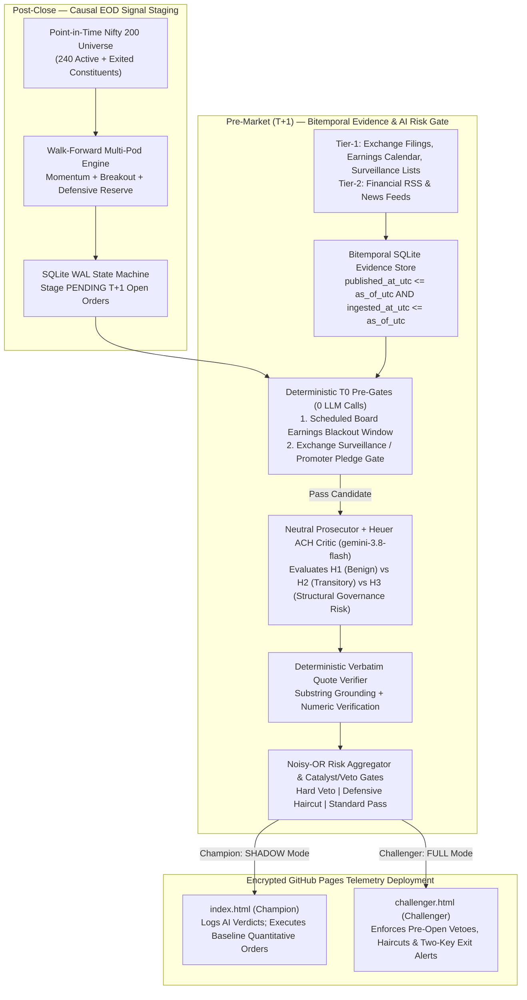

# NIFTY 200 EOD Quantitative Engine & Point-in-Time AI Research Advisor — Encrypted Telemetry & Engineering Post-Mortem

[-10b981?style=flat-square)](https://himanshu2408.github.io/nifty-eod-dashboard/)
[-6366f1?style=flat-square)](https://himanshu2408.github.io/nifty-eod-dashboard/challenger.html)

[-f59e0b?style=flat-square)](#4-point-in-time-bitemporal-ai-research-advisor--championchallenger-architecture)

This repository hosts the encrypted static telemetry dashboards deployed by a private automated end-of-day (EOD) quantitative pipeline, alongside the **systems engineering post-mortem** of the initial `v2.1.0` baseline (`3.06%` CAGR, `-0.461` Sharpe) and its subsequent **Walk-Forward Out-of-Sample (OOS) + Point-in-Time Agentic Rebuild** (`14.19%` CAGR, `+9.47%` annualized net alpha after `~51.5 bps` round-trip statutory Indian cash-delivery friction).

---

## 1. Repository Artifacts & Encrypted Static Telemetry

The automated EOD and pre-market pipeline publishes two static telemetry bundles to this repository on each NSE trading day:

| Telemetry Artifact | Live URL | Execution Mode | Role in Champion vs. Challenger Loop |
| :--- | :--- | :--- | :--- |
| **[`index.html`](https://himanshu2408.github.io/nifty-eod-dashboard/)** | `https://himanshu2408.github.io/nifty-eod-dashboard/` | **Champion (`SHADOW` Mode)** | Executes the causal Walk-Forward OOS Multi-Pod Quantitative Engine as primary execution while running the Point-in-Time `gemini-3.8-flash` AI Research Advisor in **Shadow Mode** (logging structured verdicts, probabilistic risk scores, and Heuer ACH matrices without blocking baseline orders). |
| **[`challenger.html`](https://himanshu2408.github.io/nifty-eod-dashboard/challenger.html)** | `https://himanshu2408.github.io/nifty-eod-dashboard/challenger.html` | **Challenger (`FULL` AI Gate)** | Parallel execution ledger where the Point-in-Time `gemini-3.8-flash` AI Research Advisor actively enforces **pre-open vetoes**, **defensive position-size haircuts**, **pre-earnings blackouts**, and **Two-Key overnight surveillance alerts** before market open. |

> [!NOTE]
> **Why `index.html` and `challenger.html` are encrypted:** To host live telemetry on public GitHub Pages at zero infrastructure cost without exposing proprietary strategy parameters, staged orders, or live holdings publicly, the telemetry payload is encrypted at build time using client-side authenticated encryption and decrypted purely in-browser. The systems engineering post-mortem, walk-forward audit methodology, and agentic verification architecture are documented below.

---

## 2. Forensic Engineering Post-Mortem: Why Baseline `v2.1.0` Failed

In early paper-trading and point-in-time auditing across the **2021–2026 Nifty 200 universe**, the initial **`v2.1.0` Baseline Engine** failed to beat risk-free cash—generating only **`3.06%` CAGR (`2.48%` post-tax)**, **`-1.66%` annualized net alpha** against the Nifty 50, and a **`-0.461` Sharpe ratio** ($R_f = 6.0\%$) across 482 trades.

Rather than curve-fitting indicator parameters to make the backtest look better, we conducted a forensic audit of the state machine, data loader, and risk allocator. We uncovered **five compounding systems engineering and quantitative defects**:

### Defect 1: Out-of-Hours Weekend Execution Anomaly
* **What Happened:** During a Sunday run, the paper execution engine unexpectedly filled **7 unauthorized orders** while the National Stock Exchange (NSE) was closed.
* **Root Cause:** Three independent flaws interacted across boundaries:
  1. **Cache Timestamp Misattribution:** When the market data provider fell back to local cache over the weekend, it stamped the returned quote with the system execution date rather than the underlying OHLCV bar timestamp from Friday's close.
  2. **Missing Exchange Calendar & Trading-Hours Gate:** The order reconciliation state machine lacked an explicit NSE holiday and market-hours guard.
  3. **Permissive Same-Day Fill Fallback:** A fallback flag allowed orders staged during the same run (`signal_date == quote_date`) to fill immediately against stale Friday quotes instead of waiting for Monday's opening auction ($P_{T+1}^{\text{open}}$).
* **Fix & Regression Guard:** Removed same-day fill fallbacks from the live execution path, bound quote dates strictly to the bar timestamp, added hard NSE trading-calendar gates, and added a static AST regression check in CI to prevent same-day fill flags from re-entering the codebase.

### Defect 2: Pre-Ranking Universe Truncation Bug
* **What Happened:** Portfolio holdings showed severe concentration in tickers starting with `"A"` (specifically large single-conglomerate exposure) while ignoring strong trends across the broader index.
* **Root Cause:** An early debugging slice left in the universe loader truncated the alphabetically sorted constituent list *before* cross-sectional ranking, silently discarding 85% of the index constituents.
* **Fix:** Removed pre-ranking list slicing so all 200 active Point-in-Time constituents are evaluated on every bar $T$.

### Defect 3: Unnormalized Constraint Clipping (`31.6%` Capital Utilization Ceiling)
* **What Happened:** Even during sustained bull regimes, average capital deployed in `v2.1.0` was only **`31.6%`**, leaving **`68.4%` of portfolio capital permanently idle** in `0.0%`-yield cash.
* **Root Cause:** When top-ranked candidates hit corporate conglomerate group caps or sector concentration caps, the sizer clipped the excess weight to zero and terminated instead of redistributing the unused risk budget to the next highest-ranked unconstrained leaders.
* **Fix:** Implemented an iterative **water-filling risk-budget allocator** with inverse-volatility weighting that redistributes clipped group/sector capacity across unconstrained top-$N$ candidates until target regime exposure is reached (lifting average capital deployment from `31.6%` to `88.6%`).

### Defect 4: Missing Rank Cutoff in the Live Execution Path
* **What Happened:** While the research evaluator restricted entries to top-ranked candidates, the live orchestrator passed all filter-passing stocks to the portfolio sizer without a rank cutoff. When top ranks hit group/sector caps, the allocator walked down to low-conviction **Rank 40–70 laggards**.
* **Fix:** Enforced an identical cross-sectional rank cutoff across both the walk-forward evaluator and the live orchestrator.

### Defect 5: Same-Bar $P_T^{\text{close}}$ Lookahead, Survivorship Bias & Unmodeled Statutory Friction
* **What Happened:** Naïve backtests on current Nifty 200 constituents assuming execution at $P_T^{\text{close}}$ overstated historical Sharpe by `0.5–1.2`.
* **Root Cause:**
  1. **Lookahead Bias:** Daily EOD signals require the closing price finalized after the NSE closing session. Assuming fills at $P_T^{\text{close}}$ ignores overnight gap slippage ($P_T^{\text{close}} \to P_{T+1}^{\text{open}}$) and upper/lower circuit locks.
  2. **Survivorship Bias:** Backtesting only the current constituent list excludes 40 historical constituents that were delisted, merged, or dropped after severe drawdowns between 2021 and 2025.
  3. **Statutory Indian Cash-Delivery Friction:** High-turnover strategies collapse once Indian statutory delivery charges are deducted: **0.10% Securities Transaction Tax (STT) on both buy and sell delivery**, stamp duty, NSE/SEBI turnover fees, GST, depository participant (DP) sell charges, and market-impact slippage (`~51.5 bps` round-trip).
* **Fix:** Rebuilt the backtester and live engine around a **240-stock Point-in-Time (PIT) Nifty 200 registry** with strict **$T \to T+1$ next-day open execution ($P_{T+1}^{\text{open}}$)**, circuit-lock deferral, `0.0%` idle cash interest, and full statutory tax/brokerage accounting.

---

## 3. The Re-Architected Walk-Forward OOS Multi-Pod Engine

### Point-in-Time (PIT) Universe & Causal Execution Design
* **240-Stock Point-in-Time Nifty 200 Registry (`2021–2026`):** Reconstructs semi-annual NSE index replacements across 2021–2026 so that on any historical date $T$, **strictly 200 active constituents** are eligible—including all 40 exited, merged, or delisted constituents—paired with listing-maturity and institutional liquidity filters.
* **Multi-Pod Risk Allocation:** Combines three uncorrelated sleeves under a unified water-filling inverse-volatility allocator:
  * **Pod A — Cross-Sectional Trend-Consistent Momentum:** Multi-horizon momentum penalized by return-path choppiness and scaled by broad-market regime state.
  * **Pod B — Uncorrelated Stage-2 Volatility-Compression Breakout:** Captures institutional consolidation bases breaking out on volume expansion.
  * **Pod C — Order-Staged Defensive Reserve:** Allocates uninvested bear-regime cash via explicit $T+1$ open orders subject to standard ETF delivery friction.

### Walk-Forward Out-of-Sample Progression (`2021–2026` Point-in-Time Audit)

All three configurations below are evaluated under identical **zero-survivorship 240-stock PIT universe rules**, **$T \to T+1$ next-day open execution**, **`0.0%` idle cash yield**, and **~51.5 bps round-trip statutory delivery friction**:

| Metric | 1. Baseline `v2.1.0` (Broken Sizer & Truncation) | 2. Re-Engineered Single-Pod (PIT + Water-Filling) | 3. Walk-Forward OOS Multi-Pod (`LIVE DEFAULT`) |
| :--- | :---: | :---: | :---: |
| **Cumulative Net Return (After All Friction)** | `+15.44%` | `+50.15%` | **`+91.58%`** |
| **Nifty 50 Benchmark Return** | `+25.40%` (`4.72%` CAGR) | `+25.40%` (`4.72%` CAGR) | **`+25.40%` (`4.72%` CAGR)** |
| **Pre-Tax Net CAGR (After ~51.5 bps Friction)** | `3.06%` | `8.93%` | **`14.19%`** |
| **Post-Tax CAGR (Est. STCG/LTCG Drag)** | `2.48%` | `7.36%` | **`11.87%`** |
| **Annualized Net Alpha vs. Nifty 50** | `-1.66%` | `+4.21%` | **`+9.47%`** |
| **Sharpe Ratio ($R_f = 6.0\%$)** | `-0.461` | `0.198` | **`0.615`** |
| **Sortino Ratio ($R_f = 6.0\%$)** | `-0.512` | `0.264` | **`0.842`** |
| **Max Drawdown** | `8.64%` | `17.61%` | **`10.92%`** |
| **Calmar Ratio (CAGR / Max DD)** | `0.354` | `0.507` | **`1.299`** |
| **Total Closed Trades / Win Rate** | `482` (`40.9%`) | `462` (`46.5%`) | **`429` (`46.9%`)** |
| **Profit Factor / Payoff Ratio** | `1.29` / `1.54x` | `1.53` / `1.76x` | **`1.79` / `2.03x`** |
| **Avg Deployed Allocation** | `31.6%` (`68.4%` dead cash) | `71.9%` | **`88.6%`** |

### Year-by-Year Out-of-Sample Net Alpha (`Walk-Forward OOS Multi-Pod`)

| Calendar Year | Market Macro Regime | Strategy Net Return | Nifty 50 Return | Net Alpha | Strategy Max DD |
| :--- | :--- | :---: | :---: | :---: | :---: |
| **2021 (H2)** | Post-COVID Liquidity Expansion | `+10.90%` | `+10.22%` | **`+0.68%`** | `5.65%` |
| **2022** | Global Rate-Hike Cycle & Geopolitical Shock | `+10.20%` | `+4.33%` | **`+5.87%`** | `6.14%` |
| **2023** | Broad Mid/Large-Cap Bull Expansion | `+29.43%` | `+20.03%` | **`+9.41%`** | `4.19%` |
| **2024** | Election Volatility & Sector Rotation | `+16.76%` | `+8.80%` | **`+7.96%`** | `8.86%` |
| **2025** | Multiple Compression & FII Outflows | `+1.48%` | `-10.50%` | **`+11.98%`** | `8.55%` |
| **2026 (YTD)** | High-Volatility Recovery & Dispersion | `+3.36%` | `-7.61%` | **`+10.97%`** | `6.45%` |

---

## 4. Point-in-Time Bitemporal AI Research Advisor & Champion/Challenger Architecture

Pure OHLCV price action is structurally blind to overnight corporate events that invalidate technical setups between market close and the next day's opening auction: **regulatory enforcement orders, statutory auditor resignations, credit-rating downgrades, promoter pledge spikes, exchange surveillance staging (ASM/GSM), and scheduled board earnings announcements**.

To filter these structural tail risks without introducing LLM lookahead bias or prompt-driven nondeterminism, we built a **Point-in-Time Bitemporal AI Research Advisor** powered by **`gemini-3.8-flash`** (`google-genai` SDK) and deployed it in a **Champion vs. Challenger** architecture:

### Key Architectural Guardrails in the AI Research Layer
1. **Strict Bitemporal Point-in-Time Query Isolation (`published_at_utc` & `ingested_at_utc`):** Every evidence query requires an explicit `as_of_utc` ceiling (`published_at_utc <= ? AND ingested_at_utc <= ?`). A static AST gate in CI scans the research package and fails the build if any SQL query omits bitemporal bounds or invokes wall-clock `datetime.now()` inside scoring modules.
2. **Deterministic Zero-LLM Pre-Gates:**
   * **Pre-Earnings Blackout Filter:** Candidates approaching scheduled board financial-result announcements are deterministically deferred with **zero LLM calls**—avoiding binary overnight earnings gaps while leaving existing winning trends untouched.
   * **Exchange Surveillance Pre-Gate:** Tickers entering heightened exchange surveillance stages or exhibiting structural promoter-pledge spikes are deterministically vetoed before invoking `gemini-3.8-flash`.
3. **Neutral Prosecutor + Heuer ACH (Analysis of Competing Hypotheses) Critic:** Instead of asking an LLM for a naive sentiment score (which suffers from sycophantic bullish bias), the structured prompt enforces **Richards Heuer's Analysis of Competing Hypotheses (ACH)** across three competing hypotheses:
   * $H_1$: Routine / Benign corporate noise (no thesis impact)
   * $H_2$: Transitory short-term volatility catalyst (triggers defensive position-size haircut)
   * $H_3$: Structural governance, regulatory, auditor, or solvency impairment (triggers hard `VETO` on verified Tier-1 exchange filings)
4. **Deterministic Verbatim Substring Verification:** Every LLM risk finding must cite an exact `evidence_id` and `verbatim_quote`. A deterministic Python verifier checks normalized substring overlap against the raw evidence store; any ungrounded claim or hallucinated number is automatically downgraded to `ABSTAIN` (`confidence = 0.0`).
5. **Two-Key Overnight Surveillance for Held Positions:** While staged pre-open `BUY` orders can be autonomously vetoed or resized in Challenger (`FULL`) mode, the AI Research Advisor **never auto-liquidates existing portfolio holdings**. Instead, when Tier-1 filings trigger a Two-Key governance/regulatory alert overnight, the dashboard raises a high-priority **`RED EXIT ALERT`** on `challenger.html` while keeping the deterministic trailing stop sovereign.

---

## 5. How This Post-Mortem Informed [`enterprise-context-scout`](https://github.com/himanshu2408/enterprise-context-scout)

The engineering lessons from debugging `v2.1.0` directly shaped the quantitative research verification architecture in **[Enterprise Context Scout](https://github.com/himanshu2408/enterprise-context-scout)**:

* **Deterministic Market-Regime Quant Scepticism Gate:** When `enterprise-context-scout` harvests and synthesizes quantitative finance papers across `IN_NSE`, `DE_XETRA`, and `US_EQUITY` (300 arXiv/OpenAlex full-text papers, 14,331 chunks), its deterministic verification gate automatically inspects extracted claims for **statutory market friction** ($\ge 15\text{ bps}$ `IN_NSE` STT/delivery costs), **point-in-time survivorship controls**, and **circuit-breaker / overnight gap execution constraints**—preventing the synthesis agent from presenting frictionless same-bar close backtests as actionable production strategies.
* **Out-of-Band Security & AST Regression Gates:** Just as this system uses static AST gates in CI to forbid same-day execution fallbacks and un-bitemporal SQL queries, `enterprise-context-scout` enforces 21 deterministic regression guards and kernel-level PostgreSQL 17 `FORCE ROW LEVEL SECURITY` so safety invariants never rely on LLM prompt compliance.
